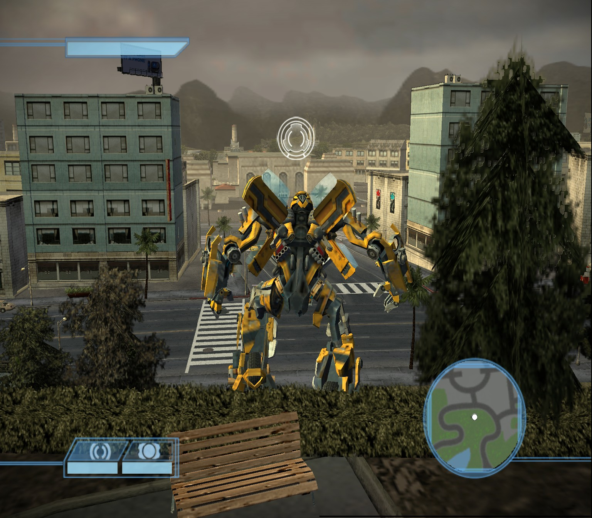
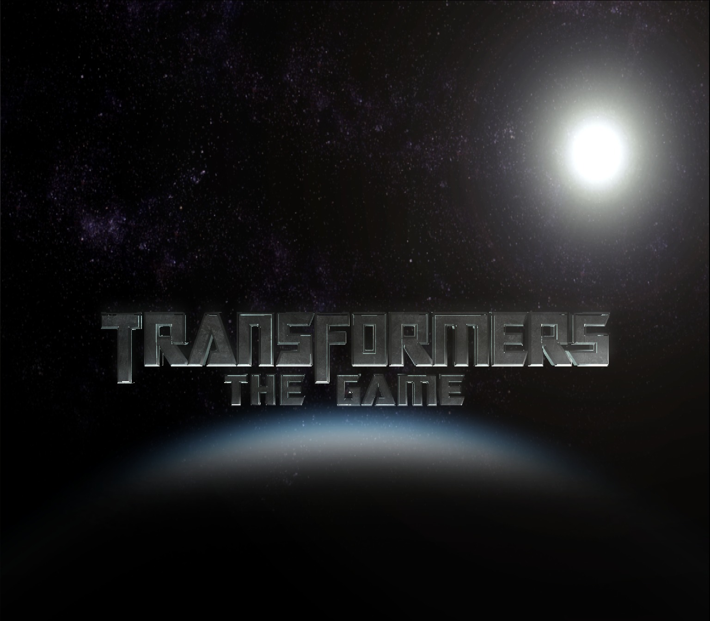
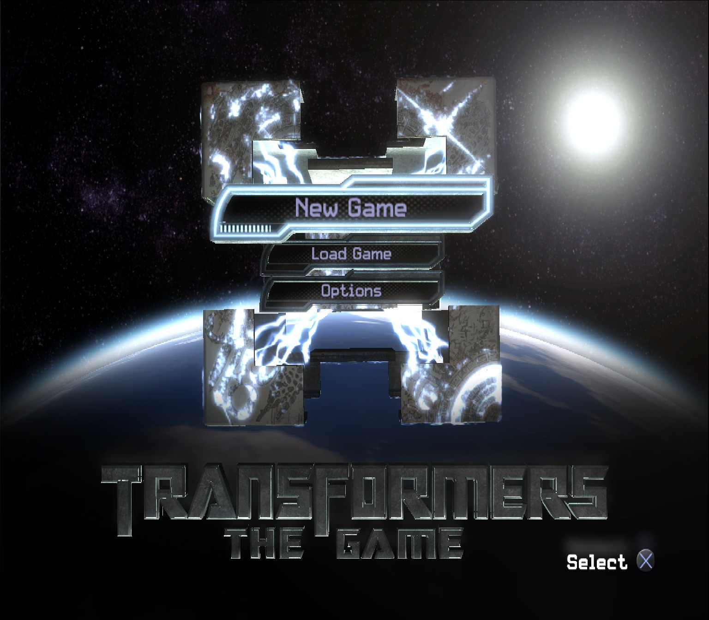
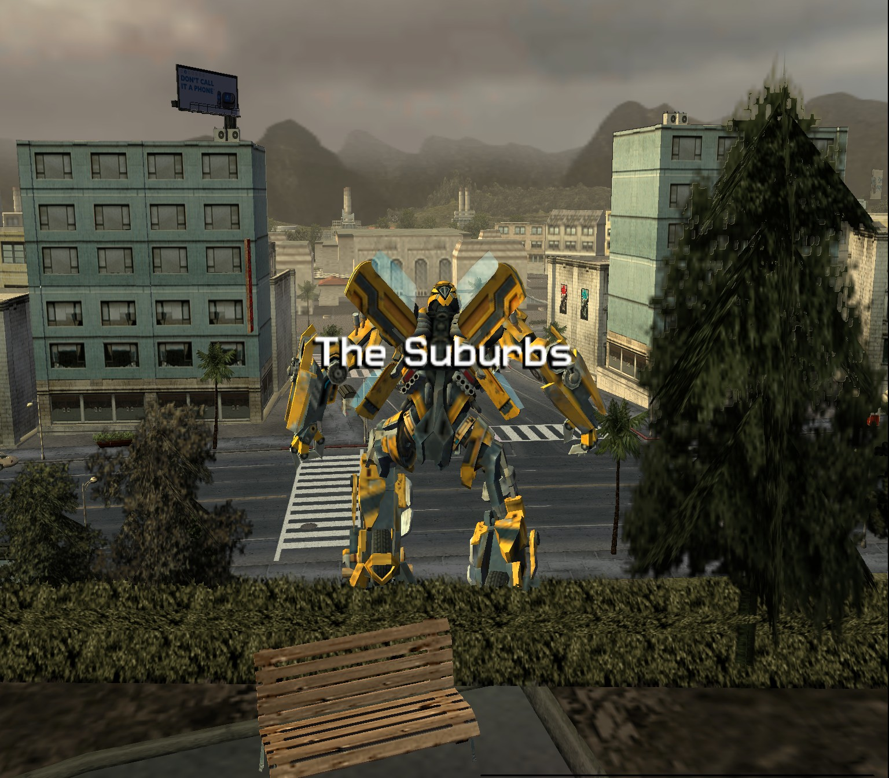
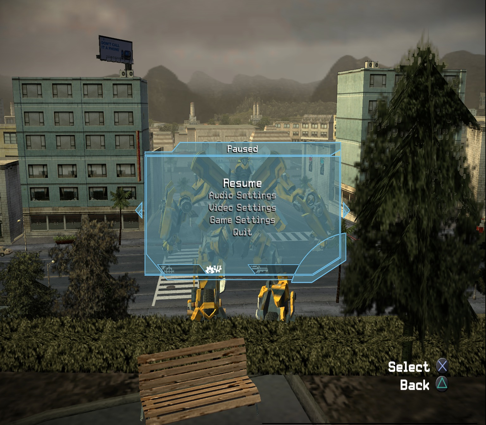
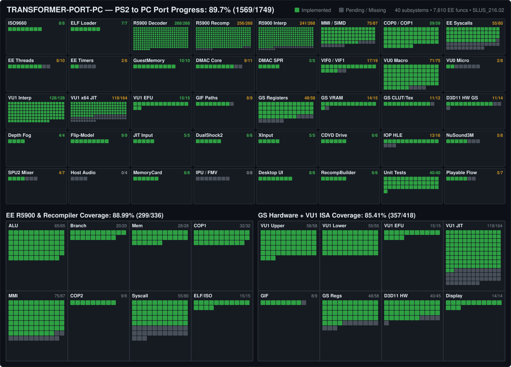

# TRANSFORMER-PORT-PC — Transformers: The Game (PS2) Native Windows x64 Port

A native Windows x64 static recompiler and PlayStation 2 hardware-compatibility runtime for **Transformers: The Game (USA)** (`SLUS_216.02`).

> **Legal Notice**: This repository contains **zero** copyrighted game assets, executables, BIOS/firmware, or disc images. You must supply your own legally dumped PlayStation 2 ISO of *Transformers: The Game* and generate the recompiled native module locally using `TransformersRecompBuilder.exe` or the `Transformers.exe` Desktop UI. Your ISO is accessed strictly **read-only**.

---

## Screenshots (3× HD Direct3D 11 Hardware GS)

Captured directly from `Transformers.exe` running *Transformers: The Game (USA)* (`SLUS_216.02`) at **3× HD (`1536×1344`)** via `D3D11GsRenderer`:

| Live Bumblebee Gameplay (*The Suburbs*, HUD & Minimap) |
| :---: |
|  |

| Title Screen (117+ FPS @ 3× HD) | AllSpark Menu (66–68 FPS @ 3× HD) |
| :---: | :---: |
|  |  |

| *The Suburbs* Intro (GPU `PSMZ16 → PSMT8H` Depth Fog) | Paused Menu Overlay (50–64 FPS @ 3× HD) |
| :---: | :---: |
|  |  |

---

## PS2 → PC Port Progress

Overall weighted completion across all 40 audited subsystems: **89.7% (`89.71%`, 1,569 / 1,749 items)** — unweighted subsystem card average: **83.12%**.



### Detailed Coverage & Honest Remaining Gaps

- **EE R5900 & Recompiler Coverage**: **`88.99%` (`299 / 336`)** — `7,610 / 7,610` (`100.00%`) `SLUS_216.02` ELF functions discovered & emitted (`901,040 / 901,040` R5900 instructions decoded, `0` unknown).
- **GS Hardware + VU1 ISA Coverage**: **`85.41%` (`357 / 418`)** — `128 / 128` (`100.0%`) VU1 interpreted ISA ops + `5 / 5` pipeline hazards; `119 / 164` (`72.6%`) VU1 x64 JIT native ops (remaining `38 / 70` lower ops run via JIT C++ fallback so all 28 `.vutext` programs execute in JIT blocks).

| Subsystem Area | Progress | Done / Total | Status & Honest Notes |
| --- | ---: | ---: | --- |
| **ISO9660 / ELF / GuestMemory / DMAC SPR** | `100.0%` | `30 / 30` | Complete (`ISO9660 8/8`, `ELF 7/7`, `GuestMemory 10/10`, `DMAC SPR 5/5`) |
| **R5900 Decoder, CodeGen & MMI (`Recompiler`)** | `96.1%` | `599 / 623` | `Decoder 268/268 (100.0%)`, `CodeGen 256/268 (95.5%)`, `MMI / SIMD 75/87 (86.2%)` |
| **R5900 Fallback Interpreter & EE Core** | `84.1%` | `306 / 364` | `Interp 241/268 (89.9%)`, `Syscalls 55/80 (68.8%)`, `Threads 8/10 (80.0%)`, `Timers 2/6 (33.3% — stubs, no IRQ)` |
| **COP0 / COP1 FPU / VU0 Macro & Micro** | `93.0%` | `132 / 142` | `COP0/1 59/59 (100.0%)`, `VU0 Macro 71/75 (94.7%)`, `VU0 Micro 2/8 (25.0% — mem mapped, no micro runner)` |
| **VU1 Interpreter, EFU & x64 JIT** | `85.3%` | `262 / 307` | `VU1 Interp 128/128 (100.0%)`, `EFU 15/15 (100.0%)`, `x64 JIT 119/164 (72.6%)` |
| **GIF / GS / D3D11 HW GS / Depth Fog** | `85.7%` | `96 / 112` | `GIF 8/9 (88.9%)`, `GS Regs 48/58 (82.8%)`, `VRAM 14/15 (93.3%)`, `CLUT/Tex 11/12 (91.7%)`, `D3D11 HW 11/14 (78.6% — no AA1/DTHE/FGE)`, `Depth Fog 4/4 (100.0%)` |
| **DXGI Flip-Model / Input / VMC / CDVD / UI** | `100.0%` | `45 / 45` | `Flip-Model 9/9`, `JIT Input 5/5`, `DS2 6/6`, `XInput 5/5`, `CDVD 6/6`, `MemoryCard 6/6`, `Desktop UI 8/8` |
| **IOP HLE / NuSound3M / SPU2 / Host Audio** | `62.9%` | `22 / 35` | `IOP HLE 13/16 (81.3%)`, `NuSound3M 5/8 (62.5%)`, `SPU2 Mixer 4/7 (57.1%)`, `Host Audio 0/4 (0.0% — no WASAPI/waveOut PCM sink yet)` |
| **IPU / FMV Video (`MOVIES.DAT`)** | `0.0%` | `0 / 8` | DMAC IDs present; no MPEG-2 / IPU bitstream decoder yet |
| **DMAC Core / VIF0-1 / Builder / Tests / Flow** | `92.8%` | `77 / 83` | `DMAC 9/11 (81.8%)`, `VIF0/1 17/19 (89.5%)`, `Builder 6/6 (100.0%)`, `Unit Tests 40/40 (100.0%)`, `Playable Flow 5/7 (71.4%)` |

---

## Verified PC Features & Architecture

```
User PS2 ISO (read-only)
   │
   ├─► ISO9660 + ELF32 + R5900 Static Recompiler (Recompiler/ + Builder/)
   │     └─► Translates all 7,610 EE functions (901,040 / 901,040 R5900 insns) -> C++20 DLL
   │
   └─► Native Windows x64 Runtime (Runtime/ + Graphics/Direct3D12/ + Platform/Windows/)
         ├─► EE Memory, Cooperative EE Threads, Syscalls, DMAC, VIF, GIF, IOP HLE, SPU2, DS2, VMC
         ├─► Windows x64 SSE2 VU1 JIT (Vu1JitX64) + Cooperative R5900FallbackInterpreter
         └─► D3D11 Hardware GS Renderer (1x–4x HD) ──► DXGI Flip-Model Presenter
```

### Direct3D 11 Hardware GS Renderer (`D3D11 HW GS + Flip`)
- **Native 1×–4× HD Internal Resolution Scaling**: GPU-resident render targets and depth buffers with automatic CPU software GS fallback (`Runtime/GS/GsState.cpp`, `Graphics/Direct3D12/D3D11GsRenderer.cpp`).
- **Accurate PS2 Blending & Alpha Test**: GPU 2-pass `AFAIL` handling (`FB_ONLY`, `ZB_ONLY`, `RGB_ONLY`), dual-source PS2 alpha blending (`D3D11_BLEND_SRC1_ALPHA` / `D3D11_BLEND_INV_SRC1_ALPHA`), and logical `SCANMSK` parity masking.
- **GPU Depth Fog (`PSMZ16 -> PSMT8H`)**: Sampleable GPU Z-buffer (`DXGI_FORMAT_R32_TYPELESS` with `D32_FLOAT` DSV / `R32_FLOAT` SRV) and 256×1 GPU CLUT LUT for clean, hardware-accelerated depth-to-CLUT atmospheric fog.

### Ultra-Low-Latency Windows Presentation
- **DXGI Flip-Model**: `DXGI_SWAP_EFFECT_FLIP_DISCARD`, `SetMaximumFrameLatency(1)`, and `DXGI_PRESENT_ALLOW_TEARING` immediate presentation when VSync is disabled (`Win32Presenter.cpp`).
- **Event-Driven Wakeup & Frame Pacing**: Win32 event (`CreateEventA` / `MsgWaitForMultipleObjects`) presentation wakeup, Optimal 60 Hz Frame Pacing, and Just-In-Time (JIT) Input sampled right before PADMAN DMA (`DesktopUi.cpp`).
- **Alt-Tab / Minimize Safe**: Thread-safe D3D11 context protection via `ID3D10Multithread::SetMultithreadProtected(TRUE)`.

### CPU & Vector Unit Execution
- **Windows x64 SSE2 VU1 Basic-Block JIT (`Vu1JitX64`)**: Persistent L2 code cache with full PS2 VU1 hardware accuracy (`ISW`/`ISWR` operand order, `WAITP` `0x7B`, 1-cycle `XGKICK` delay, `LQI`/`SQI`/`LQD`/`SQD` VI branch-delay hazard with consecutive-write chaining, and cycle-accurate `DIV`/`SQRT`/`RSQRT` `Q`-pipeline latency).
- **Cooperative `R5900FallbackInterpreter`**: Handles indirect jump tables and uncompiled fallback paths with cooperative thread yielding alongside the statically recompiled `SLUS_216.02` x64 DLL.

### Verified Status (`SLUS_216.02`, 3× HD)
- **Title Screen**: **117+ FPS** @ 3× HD
- **AllSpark Menu**: **66–68 FPS** @ 3× HD
- **Autobot Mission 1 (*The Suburbs*)**: Live playable 3D Bumblebee gameplay with full HUD and minimap at **50–64 FPS** @ 3× HD
- **Automated Verification**: **40 / 40** unit tests passing (`transformers_tests.exe`) and **6 / 6** bit-exact D3D11 HW GS parity checks (`diff=0`).

---

## Quick Start (Windows x64)

### Prerequisites
- Windows 10 / 11 (x64) with Direct3D 11 capable GPU
- CMake 3.20+, Ninja, and a C++20 toolchain (MinGW-W64 GCC / Clang)
- A legally obtained PS2 ISO of *Transformers: The Game (USA)* (`SLUS_216.02`)

### 1. Configure & Build
Run from the root of the cloned `TRANSFORMER-PORT-PC` repository:

```powershell
cmake -S . -B build-win64 -G Ninja -DCMAKE_BUILD_TYPE=Release
cmake --build build-win64
```

This produces `Transformers.exe`, `TransformersRecompBuilder.exe`, and `transformers_tests.exe` in `build-win64/`.

### 2. Run the Test Suite

```powershell
ctest --test-dir build-win64 --output-on-failure
```

### 3. Build the Recompiled Module & Play

**Option A — Desktop UI (Recommended):**
1. Launch `.\build-win64\Transformers.exe` (no CLI arguments required).
2. Click **Select PS2 ISO...** to browse to your legally obtained ISO.
3. Click **Recompile** to generate C++20 shards and compile the native x64 module DLL (cached via SHA-256).
4. Click **Play**! Settings (resolution scale `1x`–`4x`, aspect ratio `4:3` / `16:9` / `Stretch`, VSync, bilinear filtering, input deadzone/sensitivity, audio, and Virtual Memory Card path) are saved to `%LOCALAPPDATA%\TransformersNative\settings.ini`.

**Option B — CLI Builder & Headless Runner:**

```powershell
# 1. Inspect ISO / ELF / R5900 coverage only:
.\build-win64\TransformersRecompBuilder.exe --iso "path\to\Transformers.iso" --inspect-only

# 2. Generate C++20 shards and compile the Windows x64 module DLL:
.\build-win64\TransformersRecompBuilder.exe --iso "path\to\Transformers.iso" --out .\build-win64\recomp_out --compile-dll --runtime-root .

# 3. Launch GUI with preselected ISO & module, or run headless with D3D11 HW GS at 3x HD:
.\build-win64\Transformers.exe --iso "path\to\Transformers.iso" --module .\build-win64\recomp_out\SLUS_216.02_recomp.dll
.\build-win64\Transformers.exe --iso "path\to\Transformers.iso" --module .\build-win64\recomp_out\SLUS_216.02_recomp.dll --headless --hw-gs --res-scale 3 --ms 15000 --auto-press --profile
```

<details>
<summary>Verified CLI Flags (<code>Transformers.exe</code> &amp; <code>TransformersRecompBuilder.exe</code>)</summary>

**`Transformers.exe`** (`Platform/Windows/main_win.cpp`):
- `--iso <path.iso>`: Path to read-only PS2 ISO
- `--module <recomp.dll>` / `--dll <recomp.dll>`: Path to compiled x64 module DLL
- `--memcard <dir>`: Virtual Memory Card directory (default: `MemoryCard0`)
- `--headless`: Run without creating the Desktop UI window
- `--hw-gs`: Enable D3D11 Hardware GS Renderer in headless mode
- `--res-scale <1..4>`: Internal resolution scale factor (`1` to `4`) for headless `--hw-gs`
- `--ms <N>`: Headless run duration in milliseconds (default: `4000`)
- `--max-calls <N>`: Static call limit in headless mode (`0` = unlimited, default: `200000`)
- `--auto-press`: Pulse Start/Cross automatically in headless mode
- `--profile`: Print per-window subsystem frame timing and counter telemetry
- `--dump-frame <path.bmp>` / `--dump-dir <dir>`: Dump presented BMP frame(s) in headless mode
- `--help` / `-h`: Print usage information

**`TransformersRecompBuilder.exe`** (`Builder/Application/main.cpp`):
- `--select`: Open native Windows file picker for a PS2 ISO
- `--iso <path.iso>`: Input PS2 ISO path
- `--inspect-only`: Inspect ISO, `SYSTEM.CNF`, ELF, and R5900 coverage without codegen
- `--out <dir>`: Output directory for reports and generated C++20 shards
- `--cache <dir>`: Override persistent build cache directory
- `--ghidra-csv <file>`: Import additional function addresses from a Ghidra CSV
- `--max-funcs <N>`: Limit number of emitted functions (`0` = all)
- `--compile-dll`: Compile the generated C++20 shards into a Windows x64 DLL
- `--runtime-root <dir>`: Path to the `TransformersNative` source root (for `--compile-dll`)
- `--target <arch>`: Target architecture (`win64-x86_64`)
- `--force`: Bypass the persistent build cache

</details>

---

## Controls

`Transformers.exe` supports simultaneous **Keyboard** and **XInput Controller (Port 0)** input with DualShock 2 actuator rumble (`DesktopUi.cpp`):

| DualShock 2 Input | Keyboard Binding | XInput Gamepad |
| --- | --- | --- |
| **Left Analog Stick** | `W` / `A` / `S` / `D` | Left Thumbstick |
| **D-Pad** | `Up` / `Left` / `Down` / `Right` Arrows | D-Pad |
| **Right Analog Stick** | `I` / `J` / `K` / `L` or Numpad `8` / `4` / `5` / `6` | Right Thumbstick |
| **Start** | `Enter` | Start |
| **Select** | `Backspace` or `Right Shift` | Back |
| **Cross (✕)** | `Space`, `Z`, or `N` | `A` |
| **Circle (○)** | `X` or `M` | `B` |
| **Square (□)** | `C` or `B` | `X` |
| **Triangle (△)** | `V` or `F` | `Y` |
| **L1 / R1** | `Q` / `E` | LB / RB |
| **L2 / R2** | `1` / `3` | LT / RT |
| **L3 / R3** | — | Left / Right Thumbstick Click |
| **Fullscreen Toggle** | `F11` | — |

---

## Project Structure

```text
.
├── CMakeLists.txt                   # Windows x64 CMake build configuration
├── Builder/                         # SHA-256 build cache, recomp pipeline, CLI builder
├── Graphics/
│   ├── Common/                      # Shared IGraphicsBackend & GraphicsSettings interfaces
│   └── Direct3D12/                  # D3D11 Hardware GS renderer & Win32 DXGI Flip-Model presenter
├── Platform/
│   └── Windows/                     # Transformers.exe entrypoint, Win32 Desktop UI & input polling
├── Recompiler/                      # ISO9660 reader, ELF32 parser, R5900 decoder, analyzer, C++20 codegen
├── Runtime/                         # EE memory/CPU/syscalls, VU0/VU1 + x64 JIT, DMAC, VIF, GIF, GS, IOP, SPU2, DS2, VMC
├── Tests/                           # Unit & integration test suite (transformers_tests)
└── docs/
    └── AUDIT_AND_ARCHITECTURE.md    # Milestone engineering log & reference architecture study
```

See [docs/AUDIT_AND_ARCHITECTURE.md](docs/AUDIT_AND_ARCHITECTURE.md) for the milestone log and clean-room reference architecture notes.
